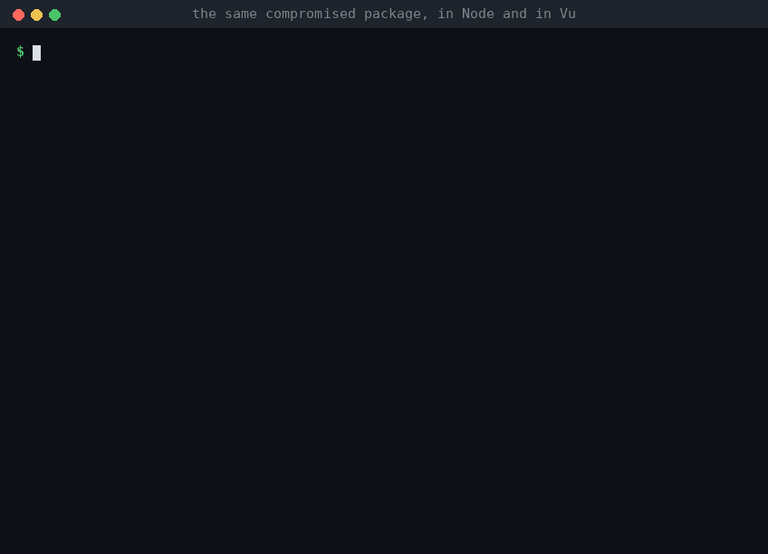
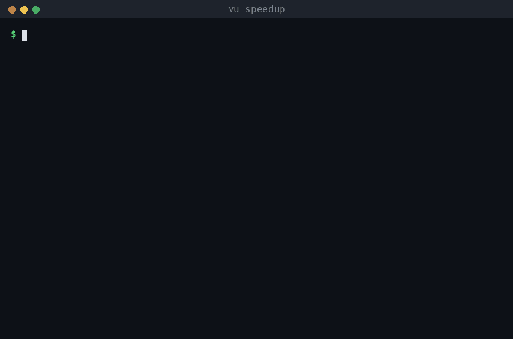

# Vu

**A backend language where the common security mistakes don't compile, whoever writes the code:
you, or the AI you asked.** Vu is small, compiled and memory-safe, with Python-style syntax. Its
compiler and standard library turn the usual ways web backends get hacked into compile errors:

- **SQL injection doesn't compile.** `pg.query`, `pg.exec` and SQLite's `query` and `exec` take SQL
  written in the program; text built at run time can't be passed there, so values go in only as
  `$1, $2`. (The one way to run SQL text, `run_sql`, is for migration files and consoles, and takes
  no values.)
- **XSS doesn't compile.** Templates escape every value, and text becomes HTML only through an
  explicit `web.trust`.
- **A package can't steal your secrets.** Each dependency gets only the capabilities its `vu.pkg`
  line grants: files, the network, the environment (where tokens live), C. A compromised update that
  reaches for any other stops the build, naming the package:

  

- **Every route says who may call it.** `web.get(&app, "/admin", web.Only(is_admin), admin)`; a route
  without its `web.Anyone`, `web.SignedIn(...)` or `web.Only(...)` doesn't compile, so an endpoint
  nobody decided about can't ship by accident.
- **No forged requests to cloud credentials.** The HTTP client never connects to the metadata
  address (169.254.169.254, in any spelling), checks addresses so DNS can't switch them, and
  `http.get_public` keeps URLs from users off your private network.
- And the rest done the way that's hard to get wrong: no memory bugs and no garbage collector, CSRF
  tokens, cookies HttpOnly/Secure/SameSite by default, password hashes compatible with Django's,
  rate limits for sign-in, path traversal and open redirects refused, TLS checks that can't be
  turned off.

```
curl -fsSL https://vulang.org/install | sh
vu new app notes      # a web app with accounts on PostgreSQL: every route with its Who, CSRF-checked forms
```

What it doesn't cover: which rows a signed-in user may see (queries still say
`where user_id = $2`), logic mistakes, secrets you print yourself, C code you grant `ffi`, and bugs in
Vu itself. [BREAK_IT.md](BREAK_IT.md) is how to report one.

## Speed up slow Python

**Make slow Python fast, and check that nothing changed.** `vu speedup` takes a slow Python function, gets
a version of it in Vu (written by a model, your coding agent, or you), checks that it gives exactly
the same answers as your Python on thousands of inputs, and swaps it in only if it's faster. Anything
the Vu version can't handle runs your Python instead.



Ports of real, widely used pure-Python code, each checked on thousands of inputs (floats to the last
bit) and measured on realistic data ([examples/speedup](examples/speedup)):

| | Python | Vu | |
|---|---|---|---|
| `difflib.get_close_matches` (the standard library's "did you mean?"), 10,000 words | 16.5 ms | 2.07 ms | 8.0x |
| jellyfish `jaro_winkler_similarity`, a pair of names | 3.72 us | 0.55 us | 6.7x |
| jellyfish `damerau_levenshtein_distance`, a pair | 15.9 us | 1.21 us | 13.2x |
| the closest of 5,000 names | 22.6 ms | 2.37 ms | 9.6x |
| a GPS track's length, 100,000 points | 77.4 ms | 12.8 ms | 6.1x |

jellyfish ships a hand-written Rust extension for those two functions too: on the same machine it
takes 0.74 and 1.84 us a pair, so the Vu ports are faster per call. It helps functions that do their
own work in Python loops (string algorithms, parsing, scoring, numeric loops). Where Python's own C
code already does the work (`re`, `Counter`, `sorted`), the Vu version isn't faster, and `vu speedup`
measures that and leaves the function alone. How it works, and how to write a port:
[examples/speedup](examples/speedup).

## The language

Vu is a small, compiled systems language with Python-style syntax. It's designed to be cheap for
an LLM to read and write, quick to compile, free of memory bugs without a garbage collector, and
about as fast as C. The compiler checks types and ownership, translates the program to C, and
builds a native binary with the system C compiler.

```
type Tree:
  left, right: Tree?

fn make(d: Int) -> Tree:
  if d == 0: return Tree(nil, nil)
  return Tree(make(d - 1), make(d - 1))

fn check(t: Tree) -> Int:
  var n = 1
  if l = t.left: n += check(l)
  if r = t.right: n += check(r)
  return n

fn main():
  print("nodes: {check(make(arg(1, 10)))}")
```

Vu is an experiment. v0 runs on Linux (x86-64 and ARM64) and macOS (ARM64); CI runs the tests on
all three. The compiler is written in Vu.

## Getting started

Install a release (Linux x86-64 or ARM64 with glibc 2.34 or later, or macOS on Apple silicon):

```
curl -fsSL https://vulang.org/install | sh           # into ~/.vu, with the command in ~/.local/bin
brew tap vu0tran/vu https://github.com/vu0tran/vu && brew install vu0tran/vu/vu     # or Homebrew
```

The installer checks the archive against the release's SHA-256 sums; `VU_VERSION=0.2.0` picks a
version, and running it again updates. The archives are also on the
[releases page](https://github.com/vu0tran/vu/releases).

Vu builds programs through a C compiler: gcc or clang on Linux (`CC=clang` for clang), the Command
Line Tools on macOS (`xcode-select --install`), and git for packages. Or, from source: clone the
repository and run `./vu`. The first run builds the compiler from `compiler/vuc_seed.c`, the C the
compiler produces from itself, so nothing else is needed.

```
./vu run examples/binarytrees.vu 16      # build without optimization and run
./vu check examples/json.vu              # type and ownership errors only, in milliseconds
./vu build examples/nbody.vu -o nbody    # optimized binary (-O3 -march=native)
./vu build app.vu --san                  # with AddressSanitizer, UBSan and LeakSanitizer
./vu fmt app.vu                          # format in place
./vu test app_test.vu                    # run each fn test_... in its own process
./vu run --profile app.vu                # optimized, then where the CPU time went
./vu build --wasm app.vu                 # a WebAssembly (WASI) module, with zig
./vu help                                # every command and flag
```

A backend to deploy:

```
./vu new app notes                       # pages with accounts on PostgreSQL: sign-up, sign-in, forms
./vu new api notes                       # or a JSON API: sign-up, sessions by cookie or token, per-user data
cd notes && DATABASE_URL=postgresql://... ../vu run main.vu
```

It comes with a Dockerfile and a `railway.json`. Passwords, sessions, SQL parameters, cookies and
cross-site requests are handled by the standard library, so the code you (or a model) write on top
doesn't have to get them right. `examples/saas` adds Stripe, email and S3, and
[docs/backends.md](docs/backends.md) goes from an empty folder to an app deployed on Railway.

`vu lsp` gives editors the compiler's errors as you type, formatting, hover, go to definition and
completion.

The language is described in [SPEC.md](SPEC.md), which is short and starts with examples. How the
language was built, and every measurement along the way, is in [CHANGELOG.md](CHANGELOG.md).

## What it looks like

### Ownership without annotations

Every value has one owner and is freed when its owner goes out of scope. Parameters are read-only
borrows by default. A function that changes an argument declares it `var`, and the caller marks
it with `&`, so every mutation is visible where it happens. A function that keeps its argument
declares it `own`, and the argument is moved.

```
fn advance(var bodies: [Body], dt: Float): ...
advance(&bodies, 0.01)

fn add(var lexer: Lexer, own tok: Token):
  lexer.toks.push(tok)          # stored, not copied
add(&lx, t)                     # t is moved; using it again is a compile error
```

There are no lifetime annotations, no reference types and no `unsafe`. The rules are stricter than
Rust's in places: for example, a `var` argument blocks every other use of the same variable in that
call. In return, they fit in a few pages of SPEC.md. Use after move, iterator invalidation,
aliased mutation, dangling borrows and data races in parallel loops are all compile errors.
Indexing is bounds-checked, and integer overflow stops the program.

### Errors are values you must handle

```
fn parse_digit(b: Byte) -> Int throws:
  if b < '0' or b > '9': fail "not a digit: {b}"
  return int(b) - 48

let d = parse_digit(b)?              # pass it on
let d = parse_digit(b) else 0        # or use a fallback
match parse_digit(b):                # or inspect it
  ok(d): print("{d}")
  err(msg): print(msg)

let name = user.nickname else "anon" # an optional (Str?) works the same way
```

A call that can fail must be handled, or the program doesn't compile. `throws E` with an enum `E`
gives typed errors that callers can match on.

### Enums, generics, interfaces and closures

```
type Shape:
  Circle(r: Float)
  Rect(w, h: Float)

fn area(s: Shape) -> Float:
  match s:
    Circle(r): return 3.14159 * r * r
    Rect(w, h): return w * h

fn largest[T](xs: [T], better: fn(T, T) -> Bool) -> T?: ...

let k = 3
let scaled = map_all(xs, fn(x) => x * k)    # borrows k; can't outlive it
let add_n = own fn(x) => x + n              # owns a copy of n, an ordinary value
```

```
interface Shape:
  fn area(s: Self) -> Float

impl Shape for Rect:
  fn area(r: Rect) -> Float:
    return r.w * r.h

fn total[T: Shape](xs: [T]) -> Float: ...      # statically dispatched, like a direct call
let shapes: [Shape] = [Circle(1), Rect(2, 3)]  # interface values: dispatched through a table
```

`match` must cover every variant. Generic functions and types are specialized for each use and
checked separately. A borrowing closure is free to create and can't escape, and an `own` closure
can be stored, sent over a channel or run in a task.

### JSON without a tree

```
type Item:
  sku: Str
  qty: Int
  gift: Bool?

let order = from_json(body, Order)?     # checked against the type
print(to_json(order.items[0]))          # {"sku":"A-1","qty":2,"gift":null}
```

The parser and printer for each type are generated at compile time. Errors say where they occur:
`items[0].qty: expected a number at byte 49`.

### Capabilities

A program can touch files, processes, the network or C code only if `main` asks for that
capability and passes it to the code that needs it:

```
fn main(fs: Fs, net: Net) throws:
  let conf = fs.read("app.json")?
  ...
```

A function that isn't handed `Fs` can't read a file, and its signature shows it. The other
capabilities are `Os` (processes, environment, time, signals), `Net` (TCP, TLS, DNS) and `Ffi`
(calling C). A capability can also be narrowed: `dir.open(fs, path)` gives a `Dir` that reaches only
what's inside one folder, enforced by the kernel, so code handed a `Dir` can't touch any other file.

### An MCP server in Vu

`mcp/filesystem` is the Model Context Protocol filesystem server as one Vu program: the same 14 tools,
arguments, results and messages as the reference server (`@modelcontextprotocol/server-filesystem`
2.0.1, in Node), for clients of the 2026-07-28 protocol and the earlier ones.

It starts in 1.7 ms instead of 203, uses 2 MB instead of 72, and searches 2,000 files in 2.6 ms
instead of 149. And `main` opens each allowed folder as a `Dir` and passes on nothing else, so the
compiler guarantees the tools can't open a socket, start a program or read a file outside those
folders, and the kernel enforces the folder boundary. Measured on a 2-vCPU Linux VM against the
reference server on Node 22 (`mcp/filesystem/README.md` has the details):

| | Vu | Node reference |
|---|---|---|
| install | one 352 KB binary (libc only) | Node (125 MB) + 25 MB of node_modules |
| start to the `initialize` answer | 1.7 ms | 203 ms |
| memory (RSS), idle / after the runs below | 2.1 / 4.5 MB | 72 / 113 MB |
| `read_text_file`, calls per second | 15,740 | 1,811 |
| `search_files` over 2,000 files | 2.6 ms | 149 ms |
| `directory_tree` of 2,000 files | 4.2 ms | 16.2 ms |

`tests/run_mcp.sh` sends both servers the same requests (every tool, errors, bad arguments, both
protocol eras, random edits, names and glob patterns) and checks every answer is the same JSON:
12,600 answers on nine seeds, plain and under AddressSanitizer.

Four more of the reference servers are rewritten the same way, each checked against its Python
original (`mcp-server-time`, `mcp-server-fetch` and `mcp-server-git` 2026.10.28, `mcp-server-sqlite`
2025.4.25) and measured the same way:

| | Vu | Python reference |
|---|---|---|
| `mcp/time`: start / memory / `convert_time` calls per second | 1.8 ms / 1.9 MB / 12,212 | 683 ms / 69 MB / 773 |
| `mcp/fetch`: start / memory | 3.6 ms / 5.0 MB | 730 ms / 83 MB |
| `mcp/fetch`: an HTML page, local server | 107 calls/s | 8 calls/s (pure Python), 881 ms a call (Readability.js) |
| `mcp/sqlite`: start / memory / `read_query` calls per second | 2.1 ms / 3.4 MB / 15,683 | 443 ms / 57 MB / 457 |
| `mcp/git`: start / memory / `git_status` calls per second | 2.7 ms / 2.2 MB / 157 | 649 ms / 73 MB / 123 |

The fetch server answers as the reference does down to its argument errors (pydantic's messages),
its URL rewriting, its robots.txt reading (Protego), its refusal of private addresses, its
redirects and its text decoding; each of those parts is compared with the library the reference
uses on thousands of generated inputs. The Markdown of an HTML page is its own: on the 130 pages of
Readability's test suite its words agree with the reference's at a median F1 of 0.98. Its `main`
takes only `Net`, so it can't touch a file, and it connects to the addresses it checked (the
reference looks names up twice). `mcp/fetch/README.md` lists every difference.

### Tasks on every core

```
fn worker(own jobs: Chan[Int], own results: Chan[Int]):
  while true:
    let n = jobs.recv() else return
    results.send(n * n)

fn main() throws:
  let jobs: Chan[Int] = chan(16)
  let results: Chan[Int] = chan(16)
  for i in 0..4:
    spawn worker(jobs, results)
  ...
```

`spawn` starts a lightweight task. Tasks run on one thread per core, and each thread has its own
scheduler and epoll loop; a thread with nothing to do takes new tasks from a busy one. Network calls and channel operations suspend only the task that makes
them. Tasks share nothing but channels and `Shared[T]` values. A `Shared[T]` is read-only, so any
number of threads can read it without locks. If every task is waiting and nothing can wake them,
the program reports a deadlock instead of hanging. For data parallelism, `par for` splits a loop
across cores, and the compiler refuses loops whose iterations would race.

### A web server

```
import http

fn main(net: Net, os: Os) throws:
  let greeting = "hello"
  own fn route(req: http.Request) -> http.Response:
    if req.path == "/": return http.text(200, greeting)
    return http.text(404, "not found")
  http.serve(net, os, 8080, route, 5.0)?      # stops gracefully on SIGTERM or SIGINT
```

`http.serve` runs one task per connection on every core. On SIGTERM or SIGINT it stops accepting,
lets requests already in progress finish (giving up after the 5-second grace period), closes idle
connections and returns.

For an app, the `web` module adds routes with parameters, middleware, forms, cookies (signed ones
too), static files and HTML templates that escape whatever they insert:

```
import http
import web

fn user(req: http.Request, c: web.Ctx) -> http.Response:
  return web.html(200, web.render("<h1>{{name}}</h1>", [web.v("name", web.param(c, "name"))]))

fn main(net: Net, os: Os, fs: Fs) throws:
  var app = web.app()
  web.use(&app, web.logger(os))
  web.use(&app, web.same_origin)                          # refuses cross-site form posts
  web.get(&app, "/users/:name", web.Anyone, user)
  web.get(&app, "/static/*file", web.Anyone, web.files(fs, "public"))
  web.serve(net, os, app, 8080)?
```

A template is a `const` parameter, like SQL for `pg`: text from a request can be a value, never
markup. `vu new web NAME` writes a starter app with a Dockerfile, a `fly.toml`, a `railway.json` and
a README that says how to deploy it. `vu new api NAME` writes a JSON API on PostgreSQL with accounts:
sign-up and sign-in (passwords hashed as Django hashes them), sessions by cookie or Bearer token, and
data that belongs to each user, ready to deploy on Railway. `examples/saas` goes further: a paid plan
through Stripe Checkout and signed webhooks, a welcome email through Resend, and avatars uploaded
straight to S3 with presigned URLs, and a question for Claude that only paying users can ask, in about 320 lines. `vu build --static` makes a binary that needs no
shared libraries.

### Calling C

```
extern "sqlite_glue.c":
  link "sqlite3"
  type Db drop db_close
  fn db_open(ffi: Ffi, path: Str) -> Db throws
  fn db_exec(ffi: Ffi, db: Db, sql: Str) throws
```

C handles are owned like any other value and freed exactly once, by their drop function.

### SQL that can't be injected

```
import pg
var db = pg.connect(net, pg.config("localhost", 5432, "app", password, "appdb"))?
let rows = pg.query(net, &db, "select name from users where id = $1", [id])?
pg.query(net, &db, "select name from users where id = " + id, [])?   # compile error
```

The SQL parameter is `const`: its argument must be text written in the program, so values can
only travel as parameters.

### Packages that can't do more than you allow

```
# vu.pkg
need github.com/someone/pg-pool v1.2.0 net
need github.com/someone/slugify v0.3.1
```

`vu get` fetches packages with git and records each one's commit and a hash of its files in
`vu.lock`, which every build checks. A package gets only the capabilities its line grants: if a
new version of `slugify` starts reading files or calling C, the build stops until you allow it.
Packages in the registry go by name (`vu add clock` writes `need clock v1.2.0 os`), and `vu get`
refuses one whose commit or files aren't what was published.

## The standard library

Built in: strings (with Unicode case, characters and search), lists, maps, files (`Fs`), processes,
environment and signals (`Os`), TCP, TLS (OpenSSL) and DNS (`Net`), channels and timers, JSON,
hashing (SHA-256, HMAC, PBKDF2) and base64, and formatting with Python's names (`split`, `join`,
`strip`, `"{x:.3f}"`). Written in Vu, in `std/`:

- `http`: an HTTP/1.1 and HTTP/2 server (HTTP/2 by prior knowledge or ALPN over TLS) and a client that
  keeps connections open and speaks HTTP/2 to servers that offer it;
- `web`: routes, middleware, forms, file uploads, cookies, static files and escaping HTML templates, on `http`;
- `ws`: WebSockets, server and client (and WebSocket routes in `web`);
- `pg`: a PostgreSQL client (SCRAM-SHA-256, TLS, parameters only, `DATABASE_URL`s and a pool of
  connections), and `sqlite` (through libsqlite3);
- `auth`: password hashes compatible with Django's, sessions stored as hashes of their tokens, and
  CSRF tokens; `jobs`: background jobs in PostgreSQL, retried, shared by any number of workers; `stripe`: Checkout, API calls and webhook signatures; `s3`: objects and presigned
  URLs on S3, R2 and the others that speak its API; `mail`: email over SMTP or Resend; `ai`:
  Anthropic's and OpenAI's chat APIs, with retries;
- `re`: regular expressions with Python's syntax, in time linear in the text, and as fast as
  Python's on most patterns (faster on many: CHANGELOG.md, round 10);
- `zlib`: zlib, gzip and raw DEFLATE decompression, the same results as Python's `zlib` (and zlib's
  error messages), 1.2–1.3x C zlib's time on compressible data (as fast as Python's, which is C zlib,
  and twice as fast as Go's), with no capability at all and a size limit for zip bombs
  (CHANGELOG.md, rounds 12 and 13); and compression to the same formats, within 1% of C zlib's
  size at levels 6 and 9 in 1.6x its time (round 19);
- `path` and `cli`: file paths as Python's `os.path` gives them, and command-line arguments;
- `time`: UTC dates, ISO 8601 and HTTP dates, RFC 3339 parsing, and time zones from the system's tz
  database (the same answers as Python's zoneinfo for all 498 zones, 1800 to 2200);
- `log`: timestamped or JSON log lines;
- `heap`: a priority queue in a list, ordered by any comparison;
- `dir`: a folder as a capability (paths resolved inside it by the kernel); `stdio`: standard input
  by lines; `json`: JSON of any shape as a tree of values, written as JavaScript writes it; `mcp`: a
  Model Context Protocol server over stdio.

## Performance

Measured with `bench/compare.sh` on a 2-vCPU Linux VM (Intel Xeon, 2.1 GHz) on 2026-10-29: median
of 5, `-O3 -march=native`, each program's output checked against Vu's before it's timed. Seconds,
lower is better. (Earlier rounds measured on another VM, where every time was higher.)

| | binary-trees 20 | n-body 50M | fannkuch-redux 11 | nsieve 13 | mandelbrot 8000 (2 threads) | spectral-norm 8000 (2 threads) |
|---|---|---|---|---|---|---|
| C | 7.08 s, 130 MB | 2.53 s | **2.40 s** | 1.93 s | **1.75 s** | 1.97 s |
| C, Vu's allocator | 2.78 s, 66 MB | | | | | |
| C++ | 7.88 s, 132 MB | 3.00 s | 2.92 s | **1.42 s** | 1.80 s | 1.78 s |
| Rust | 7.80 s, 130 MB | **2.03 s** | 2.70 s | 1.86 s | 1.82 s | 1.78 s |
| Go | 16.04 s, 186 MB | 3.04 s | 2.80 s | 1.82 s | 1.92 s | 2.01 s |
| **Vu** | **2.66 s, 66 MB** | 2.62 s | 2.79 s | 1.88 s | 1.84 s | **1.63 s** |

- **binary-trees is an allocator result.** Vu is 2.7x faster than C that calls `malloc` and `free`
  per node, in half the memory, because the compiler knows when each node dies: freed nodes go on a
  free list for their type and new ones are carved from big chunks, with no runtime checks. C written
  with that same allocator (`bench/bt_pool.c`) ties it: 2.78 s against 2.66 s. So the win is that Vu
  does it for you, safely; it isn't faster code than C can be.
- **Every check stays on, and the rest are within 1.16x of C** (nsieve slightly ahead of it), and
  spectral-norm is ahead of all of them. Vu checks every index and every Int operation, and in hot
  loops it makes those checks cheap instead of dropping them: a loop's indexes that the loop bounds
  (`xs[i]`, `xs[i + 1]`, `xs[0]`) are checked once before it starts, and a loop that only computes
  numbers runs first with its checks recorded instead of stopping it, which lets the C compiler
  vectorize it, and again checked only if one failed (details in CHANGELOG.md, round 11). n-body
  asks for fused multiply-add: `fma(a, b, c)` gives the same result on every machine, which leaving
  the choice to the C compiler doesn't.
- **Where Rust is ahead.** n-body, by 29%: the Rust program keeps its five bodies in an array whose
  size is part of its type, so LLVM unrolls the loops over them completely and computes two
  distances at once in vector registers. Vu's bodies are in a list, whose length isn't known until
  the program runs, and gcc doesn't do that even for C with a fixed-size array (2.53 s). Vu's C,
  with the count written as a constant and an unroll hint added by hand, built with clang, runs in
  1.76 s, but clang makes binary-trees 40% and spectral-norm twice as slow, so Vu doesn't use it for
  optimized builds. fannkuch-redux (3%), nsieve (1%) and mandelbrot (1%) are close. fannkuch-redux's
  flips index the list by values read from it, which no check before the loop can cover.
- nsieve's C++ version is fast because `vector<bool>` packs the sieve into bits; the others use a
  byte per number.
- Against Python 3.13 and JavaScript on Node 22 (`bench/dyn/compare.sh`: every language pinned to one
  core, the same size for all, median of 3, outputs checked): Vu is 4.3–140x faster than Python
  (binary-trees 15x, n-body 81x, spectral-norm 140x, nsieve 4.3x, fannkuch-redux 31x, mandelbrot 32x)
  and 1.1–5.2x faster than Node (binary-trees 5.2x, the rest 1.1–1.9x). Sizes are smaller than the
  table above's for n-body (5M steps), spectral-norm (2000) and mandelbrot (4000), where Python would
  take minutes per run.
- On HTTP, a Vu server on one core handled 121k requests/s for a minimal reply and 25.5k for a
  5.8 KB JSON order parsed and answered, against 112k and 9.5k for a raw-TCP Go server (details and
  memory in CHANGELOG.md, round 7).
- **`let` of a string doesn't copy it** (2026-11-08). `let name = p.name` (a field, an element, a
  borrowed or still-used variable) used to copy the text; now the variable points at it, and the
  compiler adds a copy only just before something that could change what it points into (a write
  to `p`, `&p` given to a function, a move of `p`, a closure borrowing `name`), guarded so it happens
  once. The program sees the same values either way. In vlint on AFFiNE (built-in rules, one
  thread) the string copies made at run time went from 3.5 million to 1.6 million (107 MB to
  86 MB); the time gained is small: on n8n, vlint with oxlint's default rules 2.13-2.16 s before,
  2.03-2.07 s after (three runs each, 2 cores), vknip 7.5-7.7 s before, 7.3-7.8 s after (within
  noise). The compiler's own C has 90 such views. Attack rounds: (1) writes, list growth, map
  rehash, branches, loops, moves, `var` parameters, returns and stores of the view: nothing found;
  (2) closures, `swap`, `for var`, early exits, generics, tasks: a closure that borrowed the view
  kept a pointer into the field and saw its later value (fixed: a borrowing closure makes the view
  take its copy first); (3) a key taken from the same map, self-assignment, `?`, own closures,
  nested functions, `par for`, index loops: nothing found. Tests 756-758.
- **Rebuilds.** On a generated 20,000-line program (`bench/rebuild`, 2 cores, median of 3), an
  edit and `vu run` takes 0.64 s against 0.70 s for `cargo run`, a first `vu run` 4.36 s against
  5.19 s, and `vu check` 0.33 s against 0.53 s for `cargo check`. Builds are compiled in parts, in
  parallel, and each part is kept, so an optimized rebuild after an edit takes 2.4 s against 14.0 s
  for `cargo build --release`. Vu still loses the first optimized build, 21.2 s against 13.8 s
  (gcc does 1.8 times the CPU work on Vu's C as rustc does on the Rust; Vu's checks on every Int
  operation, which Rust's release builds leave out, are about a fifth of it), and a first build for
  a debugger, 5.9 s against 5.2 s.

## A TypeScript type checker in Vu

`ts/` holds vtsc, a TypeScript type checker written in Vu that prints the same errors as
`tsc --noEmit --strict`. On date-fns (1334 files) on a 2-core VM it checks every file in 305 ms,
with the same result as tsc, where tsc 7 (Go) takes 1009 ms and tsc 6 takes 5.1 s (2026-11-09).
On other code it lists what it doesn't model yet as not checked rather than guessing (most of
zod, remeda and jotai still are). Its parser handles the same 2.0 MB in 23 ms. Details, caveats
and how it's tested against tsc: `ts/README.md`.

The same directory holds vlint, a linter that prints exactly what oxlint prints for its 96
default rules (every warning matched on date-fns, zod, vscode, preact, excalidraw and more), and
on n8n, vitest and tldraw with their own configurations (3688, 1377 and 82 diagnostics identical;
`ts/README.md` has which rules it still lacks, such as the React Compiler's). It
takes about as much CPU as oxlint (Rust), 13 times less than Biome and 130 times less than ESLint
(measured on a loaded 2-core VM; `ts/README.md`). It's on npm as `@vu0tran/vlint`, laid out as
oxlint is, with an `oxlint` command too (`"oxlint": "npm:@vu0tran/vlint@^0.1.0"`).

## A golangci-lint replacement in Vu

`golint/` holds vgolint, a drop-in replacement for `golangci-lint run` 2.5.0: it finds and reads
the same `.golangci.yml/.yaml/.toml/.json` (v2 schema: linter sets and settings, exclusions and
presets, `//nolint`, limits, severities, diffs against git), takes the same flags and prints the
same nine output formats byte for byte, with the same exit codes. It implements the five default
linters (68 of staticcheck's checks, the IR-based ones included: 1793 of golangci-lint's 1796
findings on 21 modules, and 3151 of 3151 on six golang.org/x modules for the implemented checks,
none extra) and ten of the most enabled optional ones (misspell, unconvert, whitespace,
nolintlint, copyloopvar, nakedret, asciicheck, dogsled, predeclared, gocyclo: 1860 of 1861
findings over three configs). It's 13-43x faster than golangci-lint with both caches warm,
18-88x cold, and 15-22x in the edit loop (2-core VM, 2026-11-09). What it does and doesn't do yet: `golint/README.md`. It installs
as golangci-lint does, from release archives through an `install.sh` with the same interface or a
GitHub Action (`golint/README.md`, Install).

## A ShellCheck-compatible linter in Vu

`shellcheck/` holds vsc, a port of ShellCheck 0.11.0 (parser, variable flow, control flow and
data flow analysis, 315 of its codes) that prints the same `-f gcc` lines. On 5353 scripts from 19
repositories it prints every line ShellCheck prints for those codes, with nothing extra (41,608
of ShellCheck's 41,717 lines; the rest are 39 codes it doesn't implement yet), and it uses 31
times less CPU (14.8 s against 463 s on a loaded 2-core VM; 17 times fewer instructions under
callgrind on a sample). Details, method and what's missing: `shellcheck/README.md`.

## jq in Vu

`jq/` holds vjq, a jq 1.7.1-compatible JSON processor written in Vu (8,800 lines). It passes all
721 cases of jq's own test files (jq.test 447/447, man, onig, base64, optional) and gives
byte-identical stdout, stderr and exit status on 2980 of 3000 random filter/document pairs
fuzzed against jq. On 100 MB of JSON it pretty-prints in 1.7 s of CPU where jq takes 7.5 s, gojq
4.7 s and jaq 4.0 s, and runs `map(select(.x > 5))` in 1.4 s (jq 4.5 s, jaq 1.9 s), measured on a
loaded 2-core VM. Details and what's not done: `jq/README.md`.

## Installing the drop-in tools

Each tool installs the way the original does, under the original's command name too, so switching
is one line (`RELEASING.md` has how they are released; Linux x86-64 and ARM64 static binaries, macOS
12 or later):

| tool | replaces | npm (one line in package.json) | elsewhere |
|---|---|---|---|
| vlint | oxlint 1.90.0 | `"oxlint": "npm:@vu0tran/vlint@^0.1.0"` | release archives |
| vgolint | golangci-lint 2.5.0 | | `golint/install.sh` (golangci-lint's installer's interface), `golint/action` |
| vsc | ShellCheck 0.11.0 | `"shellcheck": "npm:@vu0tran/vsc@^0.1.0"` | archives named as ShellCheck's, `install.sh`, `shellcheck/action` (ludeeus/action-shellcheck's inputs), pre-commit hook |
| vjq | jq 1.7.1 | `@vu0tran/vjq` (`jq` and `vjq`) | binaries named as jq's (`jq-linux-amd64`, ...), `install.sh`, `jq/action` |
| vknip | knip 6.44.1 | `"knip": "npm:@vu0tran/vknip@^0.1.0"` | release archives, `install.sh` |

```sh
curl -fsSL https://raw.githubusercontent.com/vu0tran/vu/main/packaging/tools/install.sh | sh -s -- vsc   # or vjq, vknip, vlint
```

Each tool's README has an Install section: `shellcheck/README.md`, `jq/README.md`, `knip/README.md`,
`golint/README.md`, `packaging/npm/vlint/README.md`.

## Built for the model that writes it

Vu's compiler, runtime, standard library, tests and these documents were written by an AI model
(Anthropic's Claude), working in rounds that its author directed and reviewed; the changelog
records each round. Most of Vu's design follows from that:

- **Few tokens.** On the benchmark programs, Vu needs 21–42% fewer tokens than C, C++, Rust or Go
  (counted with the GPT-4o tokenizer, comments stripped, each formatted with its standard tool).
- **One way to write things.** The syntax is indentation-based, names are ASCII only, there is no
  inheritance (`x.f(y)` is just `f(x, y)`), and there is no global mutable state.
- **Errors a model can act on.** Compile errors name the variable and both places involved, and
  say what to write instead. A panic prints a backtrace with Vu file and line numbers. `vu check`
  runs only the front end, so a mistake is reported in milliseconds (0.4 s for the compiler itself,
  14,700 lines).
- **Finding things without reading them.** `vu def NAME file.vu` prints where a function, type,
  const or method is defined across every module a program loads (0.56 s across all of vlint's modules),
  and `vu check --dups` lists names defined in several. A method other languages have gets the
  Vu way in its error (`Str has no .slice(): use s[a..b]`, `lists have no .contains(): use x in xs`).
- **Checks in one command.** `tests/try.sh file.vu` checks a program, runs it, runs it again under
  the sanitizers and compares the output, and audits the generated C.

## How it's tested

`tests/gate.sh` runs every suite: about 600 targeted programs that each try to break one rule,
21 programs the compiler must refuse, every program built five ways (gcc and clang, optimized or
not, two allocators) that must print the same, JSON tests, memory tests, and network, TLS, HTTP,
HTTP/2 and WebSocket tests against Python's libraries and hand-made hostile input (including the
known HTTP/2 attacks), a real PostgreSQL server and a fake hostile one, text, regular expressions,
paths and hashing compared with Python on random input, the targeted programs again on ARM64 under
qemu, macOS builds, and the compiler built to WebAssembly checked against the native one on all
1,288 checks and formats of the targeted programs (12 minutes on a 2-core machine when little has changed, 26 when everything
is rebuilt; CHANGELOG.md, round 14). Each runs under
AddressSanitizer, UBSan and LeakSanitizer, and the threaded programs also run under
ThreadSanitizer. The compiler compiles itself, and every rebuild must reach a fixed point (stages
2 and 3 produce identical C) before it's installed. Each new feature went through rounds of
attacks until a whole round found nothing; CHANGELOG.md lists what each round found.

## Limits

- Linux on x86-64 and ARM64. The compiler also builds to WebAssembly (`tools/wasm.sh`), where it
  checks and formats but can't build programs: that's the playground on vulang.org. Programs build
  to WebAssembly (WASI) with `vu build --wasm` if they use no tasks, sockets, processes or C.
- macOS (kqueue) builds for ARM64 and x86-64 but hasn't been run on a
  Mac.
- Strings are bytes. Text functions (`chars()`, `upper()`, `normalize()`, `is_alpha()`...) read them
  as UTF-8, with Python's Unicode tables (15.1); `\w` in `re` is ASCII.
- Only new tasks move between threads: two tasks that have started on the same thread and never
  wait take turns only when one of them waits.
- The safety rules are conservative, and some correct programs need rewriting to pass.
- Tested on 10 small tasks only (CHANGELOG.md, round 20): three models wrote Vu from SPEC.md alone that
  passed every test as often as their Rust (30 of 30 each, after two compiler fixes the test found).

## Repository

| Path | What's there |
|---|---|
| `vu` | the command: builds the compiler on first use, then runs it |
| `compiler/*.vu` | the compiler, in Vu (front end, checker, C code generator, build driver) |
| `compiler/rt/` | the C runtime: memory, strings, tasks and the scheduler, JSON, TLS |
| `compiler/vuc_seed.c` | the compiler compiled to C, to bootstrap from |
| `compiler/build.sh` | rebuilds the compiler and checks the fixed point |
| `std/` | the standard library modules written in Vu |
| `examples/` | the benchmark programs and a JSON parser |
| `mcp/filesystem/`, `mcp/time/`, `mcp/fetch/`, `mcp/sqlite/`, `mcp/git/`, `mcp/vu/` | MCP servers: filesystem, time, fetch, SQLite, git, and Vu's checker for models |
| `tests/` | the test suites; `tests/gate.sh` runs them all |
| `bench/` | benchmark programs in C, C++, Rust and Go, and the scripts that time them |
| `ts/` | vtsc, a TypeScript type checker written in Vu (3.3x faster than tsc 7 on date-fns, all of it checked; see `ts/README.md`) |
| `golint/` | vgolint, a drop-in replacement for golangci-lint (see `golint/README.md`) |
| `packaging/` | release scripts: Vu's archives, Homebrew, and the drop-in tools' builds and npm packages (`RELEASING.md`) |
| `SPEC.md` | the language |
| `CHANGELOG.md` | how it was built, round by round, with measurements |
| `attic/` | the retired Python compiler |

## License

MIT ([LICENSE](LICENSE)). A few example and benchmark files carry code from other projects under
their own licenses; [NOTICE](NOTICE) lists them.
