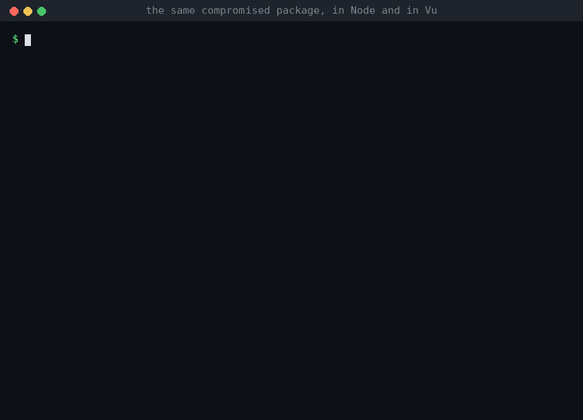

# A compromised package, in Node and in Vu

A maintainer's account is stolen and a new version of a small, popular package goes out with a few
extra lines: read the developer's `GITHUB_TOKEN` and send it to the attacker. That's how the 2025 npm
worms spread (Shai-Hulud took over 500+ packages this way).

- **Node:** the new version runs with everything the program can do. `node main.js` prints
  `hello-world`, and the token is gone.
- **Vu:** a package gets only the capabilities its line in `vu.pkg` grants: `fs` (files), `net`
  (the network), `os` (environment variables, running programs, the clock), `ffi` (C code). This
  `need slugify v1.1.0` line grants none. Code in the package that takes an `Os` or a `Net`, in any
  form (a parameter, a callback that hands one back, a struct or interface that carries one, a
  closure), doesn't compile, and the error names the package and what it asked for. The build stops
  before anything runs; using it means someone edits `vu.pkg` to grant it, where a reviewer sees it.

Reading the command line (`args()`, `arg()`) counts as `os` too, since secrets are sometimes passed
there. A `Dir` (one folder, from `dir.open`) or a closure you pass a package is what you chose to give
it. `vu.lock` pins each package's commit and the SHA-256 of its files, and the registry records the
same at publishing, so a moved tag or changed files stop the build as well.

`tests/run_pkg.sh` tries each way of smuggling a capability into a package (all compile errors).
`record.sh` reproduces the demo: it builds the package's two versions in a git repository, publishes
them to a local registry, runs both apps, and draws `demo.gif` from what they printed.
